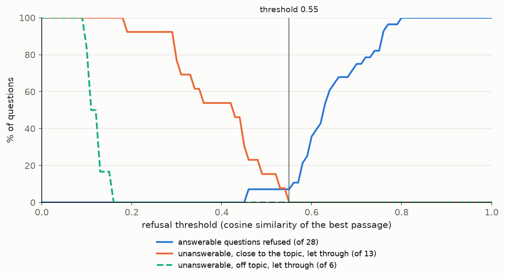
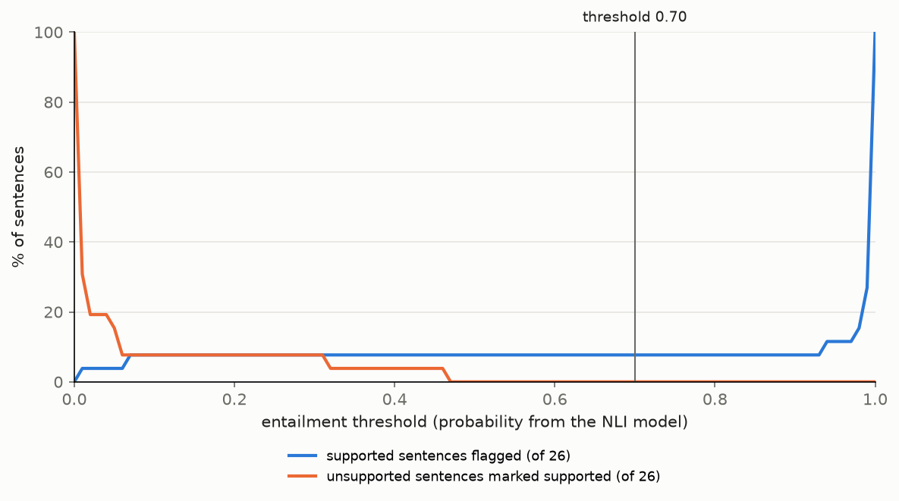

# Labelled data and the measurements made with it

Written on 23 November 2026, before any retrieval or verifier code ran, so neither set was tuned to
the results.

- `questions.jsonl`: 47 questions about the demo handbook in `demo/docs`. 28 are answerable, each with
  the file and a short piece of text the retrieved passage must contain. 19 are not answerable: 13
  close to the topic (a bike shop) and 6 far from it. They pick the refusal threshold and check
  retrieval.
- `pairs.jsonl`: 52 sentence and passage pairs labelled supported or unsupported, each with the kind
  of sentence: a copy, a paraphrase, an inference, a changed number, a mixed-up fact from elsewhere
  in the handbook, a contradiction, or an invented detail. They pick the verifier's entailment
  threshold and show where it fails.

Both sets are small and written by one person for one made-up handbook. The numbers below say how
grounded behaves on these documents, not on yours: run the scripts on your own labelled questions
before trusting a threshold.

## Running them

From the repository root, with the `ml` and `eval` extras installed (`pip install -e "api[ml,eval]"`):

```bash
python eval/retrieval.py          # does retrieval find the passage with the answer?
python eval/refusal.py --chart    # the refusal threshold
python eval/verifier.py --chart   # the verifier's entailment threshold
python eval/ragsweep/export.py && (cd eval/ragsweep && ragsweep run --out results.json)
python eval/answers.py            # Claude end to end; needs ANTHROPIC_API_KEY and costs money
```

Results go to `results/`. Each script builds its index with grounded's own ingest, embedder and
verifier code, so it measures what the app does.

## Results (25 November 2026)

### Retrieval

A hit is a retrieved passage from the labelled file that contains the labelled evidence text
(`all-MiniLM-L6-v2`, passages of whole sentences up to the chunk size, never crossing a heading).

| chunk | headings embedded | hit@1 | hit@3 | hit@5 | MRR |
|------:|-------------------|------:|------:|------:|----:|
| 256 | no  | 0.89 | 0.93 | 1.00 | 0.92 |
| 256 | yes | 0.89 | 0.96 | 1.00 | 0.93 |
| 512 | no  | 0.89 | 1.00 | 1.00 | 0.94 |
| 512 | yes | 0.89 | 1.00 | 1.00 | 0.95 |

grounded uses 256 characters with the headings embedded. Every answerable question has its passage
in the top 5, which is what the model sees. 512 ranks slightly better, but the verifier reads each
cited passage, and the NLI model is more reliable on short ones.

**ragsweep** (week 2) on the same questions, labelled per document, ranks dense retrieval with
256-character chunks among the best, as on its own corpus. With only six documents, though,
document-level labels saturate: 35 of its 36 configurations find the right document in the top 5
(`ragsweep/results.csv`). The passage-level check above is the one that separates the options.

### Refusal threshold



Rule, written before the run: an unanswerable question let through costs 2, an answerable one
refused costs 1; the threshold is the middle of the widest run of lowest-cost thresholds.

**Chosen: 0.55.** 2 of 28 answerable questions are refused ("What does a full service include?"
at 0.457 and "Can I return a wheel that was built to order for me?" at 0.459); none of the 19
unanswerable ones get through. Off-topic questions all score below 0.16, far from anything real.

The margin is thin for questions close to the topic: the lowest-cost run is the single value 0.55,
the nearest unanswerable question ("Which e-bike brands do you sell?") scores 0.542 and the
nearest answerable one above the line 0.559. Similarity alone can't separate "the shop's documents
talk about e-bikes" from "the documents answer this e-bike question". That is why there are two
more layers: the prompt tells Claude to say the documents don't cover it, and the verifier checks
whatever is said.

### Verifier



`cross-encoder/nli-deberta-v3-small` on the CPU, same cost rule (an unsupported sentence marked
supported costs 2, a supported one flagged costs 1).

**Chosen: 0.70** (lowest-cost run 0.47 to 0.93). 50 of 52 pairs are judged correctly:

| kind | correct |
|------|--------:|
| supported: copy | 9/9 |
| supported: paraphrase | 15/16 |
| supported: inference | 0/1 |
| unsupported: changed number | 7/7 |
| unsupported: contradiction | 9/9 |
| unsupported: mixed up from elsewhere | 8/8 |
| unsupported: invented detail | 2/2 |

Both mistakes are true sentences flagged as not supported, and both need two parts of the passage
put together: "Bikes that have been ridden further than 50 km are still covered by the warranty"
(the passage says "further than *that*", referring to the sentence before) and "Faulty sale items
are refunded as money" (from "refunded as store credit ... unless they are faulty"). A small NLI
model doesn't take that step. No unsupported sentence was marked supported.

**What changed on the way, and why the number is optimistic.** The first run gave the model each
passage as plain text, and it flagged 12 of the 26 supported sentences, exact copies included:
"Closed on bank holidays." doesn't say what is closed, so "The shop is closed on bank holidays"
reads as neutral. Giving the passage its headings ("Visiting the shop > Opening hours") and checking
it both whole and one sentence at a time, keeping the best score, brought that down to 2. The larger
`nli-deberta-v3-base`, tried at the same time, got 1 wrong, but only at a threshold near 0.10, so
the small model stayed. That method was chosen on these same 52 pairs, so 96% is an optimistic
figure; the per-kind table is the useful part.

### Claude end to end

`answers.py` sends every question retrieval lets through to Claude at effort `low` and `medium`
and verifies the answers. **Not measured:** it needs a paid Anthropic API key, and this project is
built and tested without one. Effort is set to `low` explicitly (Claude Opus 5.5 would otherwise
use `medium`) as the starting point for short question answering, not as a measured choice. The
script is here for anyone with a key to run.
